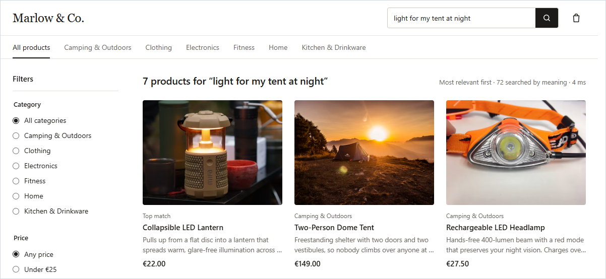

# Marlow & Co. – semantic product search

A product search that understands what you mean, not just the words you type.

**Live demo: <https://marlow-semantic-search.onrender.com>**
(it runs on free hosting, so after a quiet period the first visit can take up to a minute
while the server wakes up)



## The problem

People often describe what they *need*, not what a product is called. Someone searching for
*"something to keep my drink hot on a camping trip"* wants a thermos. But the thermos
description doesn't use any of those words, so a keyword search would suggest things like a
hot water bottle or hot sauce instead.

## What I built

- **A search API that matches by meaning** and still respects category and price filters. For
  the camping query it ranks the thermos second. The hot water bottle still comes first,
  because the words "hot water" are so close to "drink hot" (see limitations below).
- **A small demo shop**, "Marlow & Co.", with 72 products across six categories, to try the
  search the way a shopper would.
- **An evaluation** that measures how often the right product comes first, including queries
  I wrote before seeing any results.

## How the search works

1. **Filter.** The database finds the products in the chosen category and price range.
2. **Compare meanings.** A small language model, running on the server, turns the search text
   into a list of numbers that captures its meaning. Every product description was converted
   the same way in advance, so finding the best matches means finding the closest numbers.
3. **Show the closest matches.** Products that aren't close enough are left out, so an
   unrelated search says "no close matches" instead of showing random products.

## Tech choices

| Part | Choice | Why |
|---|---|---|
| Backend | Node.js, Express, TypeScript | Simple, typed, one language for the whole project |
| Products and filters | SQLite | A real database with no server to run |
| Meaning of text | MiniLM model, run locally | Free and private: no API key, no external service |
| Finding close matches | HNSW vector index (`hnswlib-node`) | Fast nearest-match search inside the app, no extra service |
| Frontend | React and Vite, plain CSS | No UI library needed for a small shop |
| Hosting | Render, one service | API and frontend together, free plan |

## Decisions I'd point out

- **Filter first, then rank.** Ranking everything and filtering afterwards can leave an empty
  page when a filter is strict. Ranking only the products that pass the filters avoids that.
- **The database is the single source of truth.** The search index is rebuilt from it
  automatically whenever products change, even while the server is running, so the two can't
  drift apart.
- **Measured, not tuned.** When the evaluation showed weak spots, I documented why they happen
  instead of rewriting product descriptions until the tests passed.
- **No "strong match" labels.** The scores turned out not to be reliable enough for that, so
  the shop just shows results in order of relevance.
- **A local model instead of an AI API.** It costs nothing and needs no keys, at the cost of
  some search quality, which the evaluation makes visible.

More on these and the trade-offs: [design decisions](docs/design-decisions.md).

## Limitations

The search works well for clear needs, but the small model has weak spots:

- **Matching words can beat matching meaning.** "Hot water bottle" outranks the thermos for the
  camping query above.
- **It understands the topic better than the direction.** For "the sunlight keeps waking me up
  … I need something to make my bedroom darker", a headlamp and a lantern rank above the
  blackout curtains. And "charge my phone *without* a power outlet" still puts a wall charger in
  the top 3.
- **Long, chatty queries score lower** than short ones, because the important words get
  watered down.
- **English only.**

The code itself isn't the cause: the evaluation shows the vector search returns exactly the
same results as an exact search. Details and numbers: [search quality
evaluation](docs/evaluation/README.md).

## Run it yourself

With Node.js 22.12+:

```bash
npm ci
npm run dev:backend    # terminal 1
npm run dev:frontend   # terminal 2, then open http://localhost:5173
```

Installing compiles one library from C++ source, so you also need a C++ compiler (on Windows,
the Visual Studio Build Tools). See [getting started](docs/getting-started.md) for the setup,
tests and other commands.

## How it was built

I built this with **Claude Code** as my main coding assistant, **JEV** for independent reviews
of the plan and code, and **ChatGPT** for talking through ideas. The direction and key
decisions were mine, and I reviewed and tested every step.
[How I used AI tools](docs/ai-development.md) · [Full conversation logs](ai-logs/)

## Documentation

- [Getting started](docs/getting-started.md): setup, commands and tests
- [Design decisions and trade-offs](docs/design-decisions.md)
- [Search quality evaluation](docs/evaluation/README.md)
- [Search API](docs/api.md)
- [Testing](docs/testing.md)
- [Deployment](docs/deployment.md)
- [How AI tools were used](docs/ai-development.md)
- [Development plan](docs/PLAN.md)
